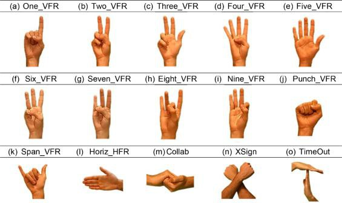
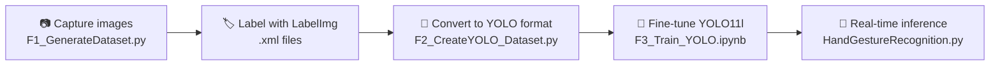

<div align="center">

# ✋ Hand Gesture Recognition using YOLO11

**Real-time detection and classification of 15 hand gestures with a fine-tuned YOLO11 Large model.**

[](https://www.python.org/)
[](https://github.com/ultralytics/ultralytics)
[](https://opencv.org/)
[](#-notebooks)
[](LICENSE)

</div>

---

## 📖 Overview

This project detects and classifies **15 different hand gestures in real time** from a webcam stream. It covers the full pipeline: building a custom dataset, annotating it, converting labels to YOLO format, fine-tuning **YOLO11 Large**, and running live inference.

Typical use cases: gesture-based control, touchless interfaces, and sign-language interpretation.

## ✨ Highlights

| | |
|---|---|
| 🎯 **Classes** | 15 hand gestures |
| 🖼️ **Dataset** | 3,000 self-captured, hand-labeled images (200 per class) |
| 🧠 **Base model** | `yolo11l.pt` (YOLO11 Large) |
| 🔁 **Training** | 100 epochs with EarlyStopping (patience = 20) |
| ⚡ **Inference** | Live webcam detection, press `q` to quit |

---

## 🗂️ Dataset

- **Classes:** 15 distinct hand gestures
- **Images:** 200 per gesture, **3,000 in total**
- **Annotation:** labeled with [LabelImg](https://github.com/tzutalin/labelImg) (Pascal VOC `.xml`), then converted to YOLO `.txt`
- **Split:** 2,700 training / 300 validation

### Gesture Classes

<p align="center">
  
</p>

---

## 🔄 Workflow



1. **Dataset preparation**
   - Images are captured from a webcam and saved into per-class folders with `F1_GenerateDataset.py`.
   - Images are annotated in LabelImg, producing `.xml` files.
   - `F2_CreateYOLO_Dataset.py` converts the XML annotations into YOLO `.txt` labels, stored in `YOLO_labels/`.
2. **Model:** `yolo11l.pt` is used as the pretrained starting point.
3. **Training:** 100 epochs, EarlyStopping (patience 20) to limit overfitting, default Ultralytics optimizer settings.
4. **Evaluation:** performed on the 300-image validation set (results below).

---

## 📊 Results

Evaluation on the validation set:

<p align="center">
  
  
  
</p>

---

## 📓 Notebooks

| Notebook | Purpose |
|---|---|
| [`F3_Train_YOLO.ipynb`](Hand-Gesture-Recognition/F3_Train_YOLO.ipynb) | Fine-tunes YOLO11l on the gesture dataset and exports `best.pt` / `last.pt` |

---

## 🚀 Getting Started

### 1. Clone the repository

```bash
git clone https://github.com/kasraSMD/Hand-Gesture-Recognition-using-YOLO.git
cd Hand-Gesture-Recognition-using-YOLO/Hand-Gesture-Recognition
```

### 2. Install dependencies

```bash
pip install -r requirements.txt
```

### 3. Run real-time detection

```bash
python HandGestureRecognition.py
```

Press **`q`** to exit.

### Model weights

The trained weights, `best.pt` and `last.pt`, are in the `runs/` folder. Use them for testing or deployment.

---

## 📁 Project Structure

```text
Hand-Gesture-Recognition-using-YOLO/
├── Guide.jpg                          # Gesture class reference
├── LICENSE
├── README.md
└── Hand-Gesture-Recognition/
    ├── F1_GenerateDataset.py          # Capture gesture images from webcam
    ├── F2_CreateYOLO_Dataset.py       # Convert XML annotations to YOLO format
    ├── F3_Train_YOLO.ipynb            # Training notebook
    ├── HandGestureRecognition.py      # Real-time gesture detection
    ├── YOLO_dataset/                  # Dataset in YOLO layout
    ├── YOLO_labels/                   # YOLO-format label files
    └── runs/                          # Trained weights (best.pt, last.pt)
```

---

## 🤝 Contributing

Contributions are welcome. Fork the repo, create a feature branch, and open a pull request.

## 📄 License

Released under the [MIT License](LICENSE).

## 🙏 Acknowledgements

- [Ultralytics YOLO](https://github.com/ultralytics/ultralytics) for the object detection framework
- [LabelImg](https://github.com/tzutalin/labelImg) for the annotation tool

<div align="center">

Made by [**kasraSMD**](https://github.com/kasraSMD) · If you find this useful, consider giving it a ⭐

</div>
